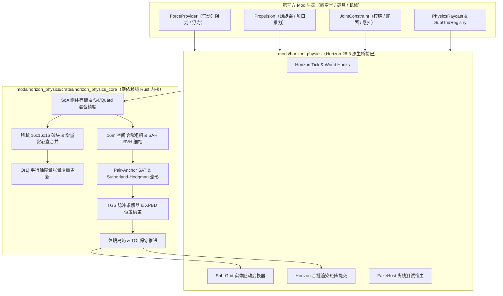
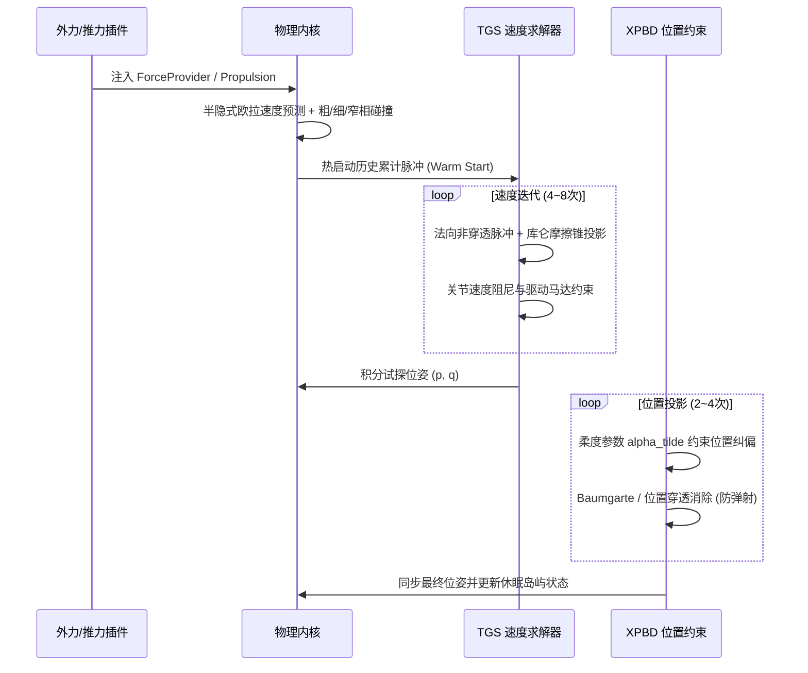

# 系统架构设计文档（`horizon_physics`）

本文档详述 `MC_rust_workbase` 中 Clean-Room 刚体与体素子网格（Sub-Grid）物理引擎的整体架构、数学模型、内存布局、碰撞管线、约束求解器以及与 **Horizon 26.3** 引擎的桥接机制。

---

## 1. 总体分层架构

系统严格划分为两层，确保核心物理算法零外部依赖、可独立在任意平台通过 `cargo test --release` 进行确定性回归与基准测试，而游戏侧桥接层仅负责与 Horizon 26.3 SDK 交互。



---

## 2. 混合精度坐标与 Pair-Anchor 相对局部化

Minecraft 世界坐标跨度可达 $\pm 3 \times 10^7$ 格。若全程使用 `f32`（有效尾数 24 bit），在距离原点仅 $10^5$ 格时 ULP 误差已达 $0.0078\text{m}$，直接导致方块接触抖动、旋转失真与穿模。

### 2.1 状态存储（双精度）

所有刚体世界位姿采用双精度数学类型：
- **世界质心位置**：$\mathbf{p}_i \in \mathbb{R}^3$，使用 `Vec3d`（`[f64; 3]`），在 $3 \times 10^7\text{m}$ 处精度仍优于 $10^{-8}\text{m}$；
- **世界朝向**：$\mathbf{q}_i \in \mathbb{H}_1$，使用 `Quatd`（`[f64; 4]`），每个子步积分后执行双精度归一化，消除正交矩阵漂移；
- **线速度 / 角速度**：在求解器局部空间中以 `f32` 或 `f64` 存储，积分回写世界位姿时统一提升至 `f64`。

### 2.2 Pair-Anchor 相对局部化机制

在窄相碰撞检测（SAT / 多边形裁切）与接触求解前，对每一对候选刚体 $(A, B)$ 选取**对锚点（Pair-Anchor）** $\mathbf{o}_{AB}$：

$$
\mathbf{o}_{AB} = \frac{1}{2}(\mathbf{p}_A + \mathbf{p}_B)
$$

将双方的世界坐标平移至以 $\mathbf{o}_{AB}$ 为原点的局部参考系后再降维至 `f32` 进行高速向量计算：

$$
\tilde{\mathbf{p}}_A = \text{cast}_{\text{f32}}(\mathbf{p}_A - \mathbf{o}_{AB}), \qquad
\tilde{\mathbf{p}}_B = \text{cast}_{\text{f32}}(\mathbf{p}_B - \mathbf{o}_{AB})
$$

对于接触点 $\tilde{\mathbf{c}}$，求解器直接以相对力臂 $\mathbf{r}_A = \tilde{\mathbf{c}} - \tilde{\mathbf{p}}_A$、$\mathbf{r}_B = \tilde{\mathbf{c}} - \tilde{\mathbf{p}}_B$ 计算雅可比矩阵。由于碰撞体仅在相邻距离内产生接触，$\|\mathbf{p}_A - \mathbf{o}_{AB}\| \ll 10^3\text{m}$，从而同时兼得 **`f64` 的超大世界稳定性** 与 **`f32` 的高带宽 SIMD 吞吐量**。

---

## 3. SoA 内存布局与稳定句柄

为最小化 CPU 缓存未命中并避免指针追逐（Pointer Chasing），刚体表采用 **Structure-of-Arrays（SoA）** 紧凑并行数组布局，通过带版本号的代际句柄（Generational Handle `BodyId { index: u32, gen: u32 }`）间接索引：

```text
BodiesSoA:
  pos:         Vec<Vec3d>       // 世界质心位置 (24 B / body)
  rot:         Vec<Quatd>       // 世界姿态四元数 (32 B / body)
  lin_vel:     Vec<Vec3f>       // 线速度 (12 B / body)
  ang_vel:     Vec<Vec3f>       // 角速度 (12 B / body)
  inv_mass:    Vec<f32>         // 质量倒数（静态体为 0.0）
  inv_inertia: Vec<Mat3f>       // 局部惯量张量逆矩阵（与世界空间缓存分离）
  force_acc:   Vec<Vec3f>       // 本步合外力累计
  torque_acc:  Vec<Vec3f>       // 本步合外力矩累计
  flags:       Vec<BodyFlags>   // 静态 / 运动学 / 休眠 / 启用 CCD 标志位
  sleep_timer: Vec<f32>         // 低速休眠计时器
```

该布局在速度积分阶段（遍历 `lin_vel`、`ang_vel`、`force_acc`、`torque_acc`）具有近乎 100% 的硬件预取命中率，且在渲染同步阶段可一次性批量抽取 `(pos, rot)` 只读视图。

---

## 4. 稀疏 $16^3$ 砖块与增量贪心盒合并

船体、飞艇与大型机械载具通常呈中空或不规则长条状，若使用稠密三维数组会浪费大量内存；若每个方块单独作为一个碰撞盒，数千方块的窄相测试开销将不可接受。

### 4.1 稀疏 $16^3$ 砖块（Sparse Brick）

- 将子网格局部整数坐标 $(x, y, z) \in \mathbb{Z}^3$ 按 $16 \times 16 \times 16$ 划分为逻辑砖块，砖块键为 `BrickCoord(x >> 4, y >> 4, z >> 4)`；
- 每个非空砖块仅保存 `4096` bit 占据位图（`[u64; 64]`，仅 `512 Bytes`）及材质/质量属性表；
- 空砖块在最后一个方块移除时自动回收。

### 4.2 增量贪心盒合并（Incremental Greedy Box Merging）

当某个方块被放置、破坏或替换时，仅将所属的 `BrickCoord` 标记为 `dirty`：
1. 在子步开始前，仅对 `dirty` 砖块执行三维贪心盒合并：
   - 沿 $X$ 轴利用位运算 `trailing_zeros` / `trailing_ones` 扫描连续占据区间；
   - 沿 $Y$ 轴检查同区间掩码连续性完成二维矩形扩张；
   - 沿 $Z$ 轴延拓生成极大轴对齐合并盒 `MergedBox { min: [u8; 3], max: [u8; 3] }`，并清除已覆盖位；
2. 砖块局部生成的合并盒集合以砖块为粒度增量替换该子网格的碰撞原语列表，再增量更新局部 BVH。

典型 2,000 方块的船体经砖块级贪心合并后，碰撞盒数量可压缩至 40–120 个，降低超过 **95%** 的碰撞原语开销。

---

## 5. $O(1)$ 平行轴惯量张量增量更新

动态载具在运行期间经常发生方块增删（如建造、炮击损毁、配重切换）。若每次修改都全量遍历所有方块重算惯量张量，复杂度为 $O(N)$。内核采用**总质量一阶矩与二阶矩守恒 + 平行轴定理（Parallel-Axis Theorem）**实现 $O(1)$ 增量维护。

设子网格原始局部原点（未经质心平移）下维护以下累计量：
- 总质量：$M = \sum_k m_k$
- 一阶矩（质量加权位置和）：$\mathbf{S}_1 = \sum_k m_k \mathbf{x}_k$
- 原点参考系惯量张量：$\mathbf{I}_0 = \sum_k \left( \mathbf{I}_{\text{block},k} + m_k \left( \|\mathbf{x}_k\|^2 \mathbf{E} - \mathbf{x}_k \mathbf{x}_k^\top \right) \right)$

其中边长为 $a=1\text{m}$、质量为 $m_k$ 的立方体方块绕自身中心的惯量张量为 $\mathbf{I}_{\text{block},k} = \frac{1}{6} m_k a^2 \mathbf{E}$。

当在局部坐标 $\mathbf{x}$ 增删一个质量变化量为 $\Delta m$（新增为 $+m$，移除为 $-m$）的方块时：

$$
M' = M + \Delta m, \qquad \mathbf{S}_1' = \mathbf{S}_1 + \Delta m \mathbf{x}
$$

$$
\mathbf{I}_0' = \mathbf{I}_0 + \Delta m \left( \frac{a^2}{6}\mathbf{E} + \|\mathbf{x}\|^2 \mathbf{E} - \mathbf{x}\mathbf{x}^\top \right)
$$

新质心与绕新质心的中心惯量张量直接通过平行轴定理逆变换在 $O(1)$ 时间内导出：

$$
\mathbf{c}' = \frac{\mathbf{S}_1'}{M'}, \qquad
\mathbf{I}_{\text{com}}' = \mathbf{I}_0' - M' \left( \|\mathbf{c}'\|^2 \mathbf{E} - \mathbf{c}' (\mathbf{c}')^\top \right)
$$

对中心惯量张量 $\mathbf{I}_{\text{com}}'$ 执行正定性钳位保护（避免退化单方块或数值抵消导致奇异矩阵），并更新逆惯量矩阵 $\mathbf{I}_{\text{com}}^{-1}$。

---

## 6. 两级碰撞加速：16m 空间哈希 + SAH BVH

### 6.1 粗相（Broad-Phase）：$16\text{m}$ 空间哈希网格

- 空间哈希单元尺寸为 $16\text{m} \times 16\text{m} \times 16\text{m}$，与 Minecraft 区块（Chunk）水平尺寸天然对齐；
- 每个活动刚体的世界 AABB（带速度膨胀边距 $\text{fat\_margin}$）哈希映射到覆盖的整数格网坐标 $(gx, gy, gz)$；
- 采用扁平化排序/计数表（避免每帧堆分配 `HashMap`），快速筛出所有重叠刚体对 `(BodyId, BodyId)` 与子网格-静态地形候选区块。

### 6.2 细相（Mid-Phase）：局部 SAH BVH

- 每个子网格在其局部坐标系内为其贪心合并盒集合构建一棵 **表面积启发式（Surface Area Heuristic, SAH）BVH**；
- 划分代价函数为：

$$
C_{\text{SAH}} = C_{\text{trav}} + \frac{S_L}{S_P} N_L C_{\text{isect}} + \frac{S_R}{S_P} N_R C_{\text{isect}}
$$

- 两个子网格相交查询时，执行双树同步遍历（Simultaneous BVH-BVH Traversal），在 Pair-Anchor 相对变换下使用 OBB-OBB 快速剔除子树；
- 与世界静态方块交互时，将子网格 AABB 投影至世界整数网格区间，按需拉取局部非空气方块碰撞箱构建临时查询窗口，无需为整个世界常驻全量静态 BVH。

---

## 7. 窄相接触：SAT 与 Sutherland-Hodgman 流形裁切

在 Pair-Anchor 局部坐标系中，所有合并盒与世界方块均可表示为有向包围盒（OBB）：

1. **分离轴定理（SAT）测试 15 条候选轴**：
   - 盒 $A$ 的 3 条局部主轴 $\mathbf{u}_0, \mathbf{u}_1, \mathbf{u}_2$；
   - 盒 $B$ 的 3 条局部主轴 $\mathbf{v}_0, \mathbf{v}_1, \mathbf{v}_2$；
   - 9 条边-边叉积轴 $\mathbf{u}_i \times \mathbf{v}_j$（对近平行退化叉积 $\|\mathbf{u}_i \times \mathbf{v}_j\| < \epsilon$ 自动跳过，防止数值爆炸）；
   - 引入微小轴偏好权重（Face Bias）避免边缘接触与面接触在帧间频繁抖动切换。
2. **接触流形生成（Contact Manifold）**：
   - **边-边接触**：直接计算两条最近特征线段的公垂点作为单点接触；
   - **面-面接触**：选定参考面（Reference Face）与入射面（Incident Face），使用 **Sutherland-Hodgman 多边形裁切算法** 依次用参考面的 4 个侧面半空间裁切入射面四边形；
   - 保留穿透深度 $d \le \text{slop}$ 的顶点，若裁切后顶点数 $> 4$，采用最大穿透点 + 最大包围面积启发式规约为最多 **4 点稳定接触流形**，并为每个接触点分配持久化特征 ID（Feature ID）以支持跨帧热启动（Warm Starting）。

---

## 8. 约束求解：TGS 与 XPBD 混合求解器

每个固定物理步长（例如 $\Delta t = \frac{1}{60}\text{s}$ 或与 Horizon 服务端 Tick 对齐后按子步细分为 $N_{\text{sub}}$ 步）的求解管线如下：



### 8.1 TGS（Temporal Gauss-Seidel）速度求解器

- 在每个子步内，将接触穿透约束写成速度级线性互补问题（LCP）：

$$
J \mathbf{v} + b \ge 0, \qquad \lambda \ge 0, \qquad \lambda (J \mathbf{v} + b) = 0
$$

- 通过有效质量 $m_{\text{eff}} = (J M^{-1} J^\top)^{-1}$ 迭代累计脉冲 $\lambda$，并对其施加非负钳位（法向）与动态/静摩擦圆锥钳位 $|\lambda_t| \le \mu \lambda_n$；
- 相较传统 SI（Sequential Impulse），子步化 TGS 显著降低大质量比（例如 100 吨战舰与 1 吨小艇）堆叠时的弹性下陷。

### 8.2 XPBD（Extended Position Based Dynamics）关节求解

面向载具铰链、舵面、弹簧悬挂与绳索等强耦合机械连接，采用 XPBD 位置级投影以保证无漂移与物理可控柔度：

$$
\Delta \lambda = \frac{-C(\mathbf{x}) - \tilde{\alpha} \lambda}{\nabla C M^{-1} \nabla C^\top + \tilde{\alpha}}, \qquad
\tilde{\alpha} = \frac{\alpha}{\Delta t^2}
$$

其中 $\alpha = \frac{1}{k}$ 为物理刚度 $k$ 的倒数。当 $\alpha = 0$ 时表现为绝对刚性铰链；当 $\alpha > 0$ 时表现为具有真实弹簧系数与阻尼的减震悬挂，且与步长 $\Delta t$ 解耦。

---

## 9. 休眠岛屿与 TOI 保守推进

### 9.1 休眠岛屿（Sleeping Islands）

- 每帧依据活跃接触边与关节边构建无向交互图，通过并查集（Union-Find）或 BFS 划分连通分量（Island）；
- 若一个岛屿内**所有**动态刚体的线速度 $\|\mathbf{v}\| < v_{\text{sleep}}$、角速度 $\|\boldsymbol{\omega}\| < \omega_{\text{sleep}}$ 持续超过阈值时间 $T_{\text{sleep}}$，整个岛屿标记为 `SLEEPING`，跳过积分、碰撞与求解；
- 当外力注入、方块修改、关节驱动或活跃刚体碰撞触及岛屿内任意成员时，即时唤醒整个岛屿。

### 9.2 TOI 保守推进（Time of Impact / Conservative Advancement）

对于高速运动刚体（如高速航空器、炮弹或快速下坠载具，当 $\|\mathbf{v}\| \Delta t + \|\boldsymbol{\omega}\| r_{\max} \Delta t > d_{\text{ccd}}$ 时）：
- 启用连续碰撞检测（CCD），基于距离下界与相对最大接近速度迭代估计最早碰撞时刻 $t_{\text{toi}} \in [0, \Delta t]$：

$$
\Delta t_{\text{step}} = \frac{d(t) - d_{\text{tol}}}{\max\left( (\mathbf{v}_B - \mathbf{v}_A) \cdot \mathbf{n} + \|\boldsymbol{\omega}_A\| r_A + \|\boldsymbol{\omega}_B\| r_B,\ \epsilon \right)}
$$

- 将高速体精确推进至 $t_{\text{toi}}$ 生成防隧穿接触并求解剩余时间片，彻底杜绝穿墙穿甲现象。

---

## 10. Sub-Grid 实体随动与 Horizon 合批渲染机制

### 10.1 Sub-Grid 实体随动（Entity Riding & Local Frame Coupling）

当玩家、生物或掉落物站立在运动中的船体/飞艇子网格上时，直接依赖世界空间摩擦会导致玩家在高速旋转甲板上滑落或视角抖动。`mods/horizon_physics` 通过三阶段随动机制解决该问题：

1. **甲板吸附判定**：通过 `PhysicsRaycast` 与脚底接触查询判定实体当前支撑面是否属于某个 `SubGridId`；
2. **增量刚体随动**：记录子网格在当前 Tick 的刚体增量变换 $\Delta T = T_{t} T_{t-1}^{-1}$：
   - 将实体位置按 $\mathbf{p}_{\text{ent}}' = T_t \left( T_{t-1}^{-1} \mathbf{p}_{\text{ent}} \right)$ 平滑迁移；
   - 将实体偏航角（Yaw）同步叠加子网格绕世界 $Y$ 轴的增量偏航 $\Delta \psi$，保持玩家站在旋转船头时视角自然随船转动；
   - 将子网格接触点处的表面线速度 $\mathbf{v}_{\text{surf}} = \mathbf{v}_{\text{grid}} + \boldsymbol{\omega}_{\text{grid}} \times \mathbf{r}$ 作为实体相对移动的基准参考速度，使玩家在疾驰甲板上自由奔跑、跳跃完全符合直觉。
3. **跨坐标系交互**：玩家在子网格上放置/破坏方块或点击按钮时，射线经世界到子网格局部逆变换 $T^{-1}$ 精准命中局部整数体素，并立即触发砖块合并与 $O(1)$ 惯量更新。

### 10.2 Horizon 合批渲染机制（Batched Sub-Grid Rendering）

在 Horizon 26.3 客户端渲染管线中：
- 每个子网格的静态方块几何体按 $16^3$ 砖块粒度离线烘焙为局部块网格（Chunk Mesh），仅在砖块被修改时增量重烘焙；
- 每帧渲染前，桥接层根据插值系数 $\alpha_{\text{render}} \in [0, 1]$ 对上一物理步与当前物理步位姿执行线性插值（`lerp`）与球面线性插值（`slerp`），再相对当前相机世界坐标 $\mathbf{p}_{\text{cam}}$ 做 `f64 -> f32` 相机锚点降维：

$$
\mathbf{M}_{\text{render}} = \text{Translate}\left(\text{cast}_{\text{f32}}(\mathbf{p}_{\text{interp}} - \mathbf{p}_{\text{cam}})\right) \cdot \text{Mat4}(\mathbf{q}_{\text{interp}})
$$

- 将所有可见子网格砖块的实例矩阵与光照探针打包写入 GPU 实例化缓冲（Instance Buffer），以极少 Draw Call 完成大规模舰队与复杂机械载具的合批渲染。

### 10.3 `FakeHost` 离线集成测试架构

`mods/horizon_physics` 将对 Horizon SDK 的读写操作抽象在窄接口 Trait 之后，并在测试配置下提供纯 Rust 的 **`FakeHost`** 内存宿主，支持在不启动完整 Minecraft 图形客户端的情况下，于 `cargo test` 中完整验证：
- 子网格创建、方块动态增删与质心/惯量漂移；
- 实体随动在平移与自转甲板上的位置守恒；
- 第三方 `ForceProvider`、`Propulsion`、`JointConstraint` 注册回调与 `PhysicsRaycast` 跨网格命中精度。
